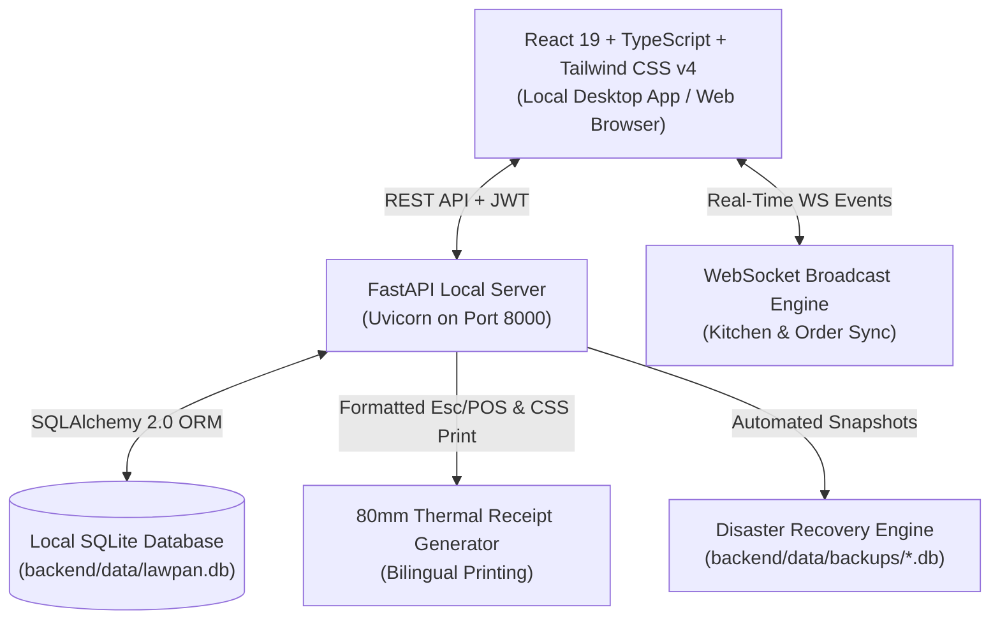

# LAW PAN (လောပန်) - Local Restaurant POS & Management System

An authentic, production-grade, 100% offline-first Restaurant POS and Management System designed specifically for **LAW PAN**, a premium Chinese restaurant operating in Yangon, Myanmar.

Designed for single Windows PC operation with zero external internet dependencies, full relational persistence in SQLite (PostgreSQL migration ready), real-time WebSockets, bilingual support (English & မြန်မာဘာသာ), and authentic Chinese visual aesthetics (Imperial Red, Charcoal Slate, and Warm Gold).

---

## 🏛️ System Architecture



---

## 👥 User Roles & Default Login Credentials

Every role features an isolated dashboard view and strict backend permission enforcement via FastAPI:

| Role | Username | Password | Access Privileges |
| :--- | :--- | :--- | :--- |
| **OWNER** | `owner` | `lawpan123` | Full master access: P&L financial reports, confidential payroll, staff creation, system settings, database backups & restore. |
| **MANAGER** | `manager` | `lawpan123` | Operations overview, table reservations, staff attendance, inventory monitoring, authorized discounts & refunds. |
| **WAITER** | `waiter` | `lawpan123` | Dining floor plan, table selection, touch POS cart, dish modifiers, multi-round ordering, kitchen ticket dispatch. |
| **CASHIER** | `cashier` | `lawpan123` | Unpaid bills queue, Cash/KPay/Wave Money/Card payment processing, 80mm thermal receipts, cash drawer balancing. |
| **KITCHEN STAFF** | `kitchen` | `lawpan123` | Kitchen Display System (KDS), station queues (Wok, Steamer, Noodle, Dim Sum, Bar), status progression (Pending → Preparing → Ready → Served). |

---

## 🥢 Core Functional Modules

### 1. Point of Sale (POS) & Ordering
- **Visual Chinese Menu**: Categorized by Rice, Noodles, Dim Sum, Poultry, Seafood, Soups, Hot Pot, and Beverages.
- **Custom Modifiers**: Wok heat, spice level chips (Mild, Medium, Extra Spicy, Non-Spicy), and custom culinary notes.
- **Price Integrity**: Historical unit prices snapshotted at time of order placement.

### 2. Dining Floor Plan & Table Management
- **Visual Section Layout**: Main Dining Hall, Outdoor Garden Terrace, Dragon VIP Room, Phoenix VIP Room, and Bar.
- **Table Operations**: Live status indicators (`AVAILABLE`, `OCCUPIED`, `RESERVED`, `CLEANING`), table order transfers, and table merging.

### 3. Kitchen Display System (KDS)
- **Live Ticket Feed**: Real-time WebSocket updates displaying elapsed preparation time and color-coded alerts for tickets exceeding 15 minutes.
- **Station Routing**: Automatic dispatch to Wok, Steamer, Noodle, Bar, or Dim Sum prep queues.

### 4. Billing, Cashier Operations & Receipts
- **Multi-Payment Support**: Cash tendered with instant change calculation, KBZPay (KPay), Wave Money, POS Card, and Split settlements.
- **80mm Thermal Receipt**: Printable formatted bill with bilingual headers, Yangon address, itemized breakdown, and thank you footer.
- **Drawer Balancing**: End-of-shift reconciliation comparing physical cash against digital wallets.
- **Authorized Refunds**: Manager/Owner approval required; automatically restores recipe ingredient stock to inventory.

### 5. Inventory & Recipe Auto-Deductions
- **Raw Ingredient Tracking**: Real-time stock for meats, produce, dry goods, seasonings, and beverages.
- **Recipe Formulas**: Binds menu dishes to exact gram/kg ingredient ratios.
- **Idempotent Stock Deduction**: Order settlements automatically deduct recipe stock without double-deduction risks.
- **Purchasing & Goods Receiving**: Supplier registry, purchase order creation, and one-click stock replenishment.

### 6. Staff Administration & Customer CRM
- **Workforce Attendance**: Shift timecards (`check-in` & `check-out`) with morning, evening, and full-day status.
- **Confidential Payroll**: Staff salaries isolated to Owner role only.
- **Customer Loyalty CRM**: Customer profile registry, dining preference notes, and point redemption (1 point = 100 MMK discount).

### 7. Financial Analytics & Profit and Loss (P&L)
- **Interactive Reports**: Filter by 7 Days, 30 Days, Quarterly, or Custom range.
- **Executive P&L Statement**: Gross Revenue - Cost of Goods Sold (COGS) = Gross Profit - Operating Expenses = Net Profit.
- **CSV Export**: One-click spreadsheet export for offline bookkeeping.

### 8. Local Backup & Security Audits
- **Zero-Cloud Local Backup**: Creates timestamped SQLite database snapshots in `backend/data/backups/`.
- **Pre-Restore Safety**: Automatically archives existing state before restoring any previous backup.
- **Immutable Audit Trail**: Event logging of all payments, refunds, backups, and price updates.

---

## 🐳 Running with Docker & Docker Compose

LAW PAN is fully containerized with production-ready multi-stage Docker builds:

### Single-Click Docker Launcher (Windows)
Double-click:
```bat
scripts\docker-run.bat
```
To stop containers:
```bat
scripts\docker-stop.bat
```

### Manual Command Line
```bash
# Build and start all services in detached mode
docker compose up -d --build

# Inspect running containers
docker compose ps

# View real-time logs
docker compose logs -f

# Stop containers
docker compose down
```

### Ports & Access:
- **Frontend Web UI**: [http://localhost:5173](http://localhost:5173) or [http://localhost](http://localhost)
- **Backend API & Swagger Docs**: [http://localhost:8000/docs](http://localhost:8000/docs)
- **Data Persistence**: Bound to `./backend/data:/app/data` (your SQLite database and backups persist on your local PC even if containers are destroyed).

---

## 🚀 Single-Click Windows Native Launch (Without Docker)

To launch the entire application on the restaurant PC:

1. Double click **`scripts\run_app.bat`** (or use the desktop shortcut).
2. The launcher will automatically:
   - Terminate any previous orphan processes.
   - Start the local FastAPI backend service on `http://127.0.0.1:8000`.
   - Start the local React application on `http://127.0.0.1:5173`.
   - Open LAW PAN in dedicated native desktop window mode.
3. To stop all services cleanly, press any key in the console or run **`scripts\stop_app.bat`**.

To generate a desktop shortcut:
```powershell
powershell -ExecutionPolicy Bypass -File scripts\create_desktop_shortcut.ps1
```

---

## 🧪 Automated Test Suite

All 17 integration and unit test suites can be executed with:

```powershell
backend\venv\Scripts\pytest backend\tests -v
```

Passing test suites:
- `test_auth.py` (Authentication, JWT tokens, bcrypt hashes)
- `test_models.py` (ORM schema validation)
- `test_dashboard.py` (Role-based metrics and queries)
- `test_menu.py` (Menu CRUD and bilingual search)
- `test_orders.py` (Multi-round ordering, price snapshotting, KDS tickets)
- `test_tables_kitchen.py` (Floor plan, order transfers, reservations, kitchen ticket lifecycle)
- `test_billing.py` (Payment settlement, receipt formatting, drawer reconciliation, refunds)
- `test_inventory.py` (Raw stock adjustments, recipes, supplier purchasing, goods receiving)
- `test_operations.py` (Staff roster, payroll privacy, attendance timecards, customer loyalty, expenses)
- `test_reports.py` (Sales overview, product rankings, P&L statement, CSV export)
- `test_system.py` (Local database backups, pre-restore snapshots, audit logs, app settings)

---

## 💻 Tech Stack Summary
- **Frontend**: React 19, TypeScript, Tailwind CSS v4, Lucide React, Recharts, Vite.
- **Backend**: Python 3.14, FastAPI, SQLAlchemy 2.0, Pydantic v2, PyJWT, Passlib/Bcrypt, Uvicorn, WebSockets.
- **Database**: SQLite (100% local NVMe/SSD persistence, PostgreSQL migration ready).
- **Environment**: Standalone Windows PC (No internet or cloud dependency required).
